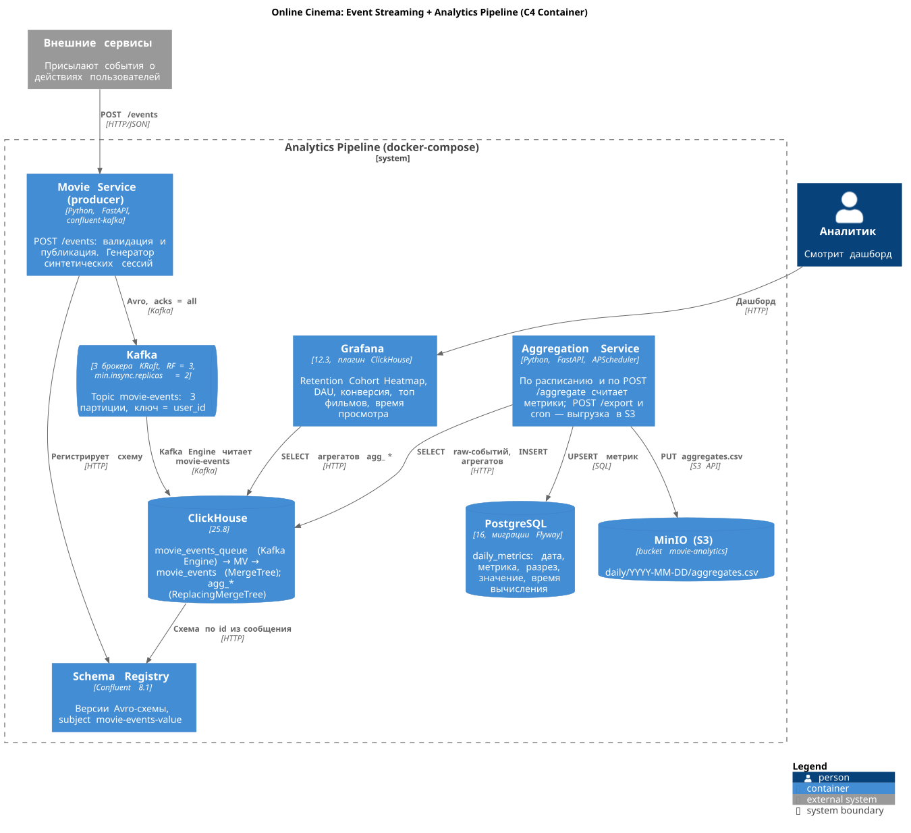
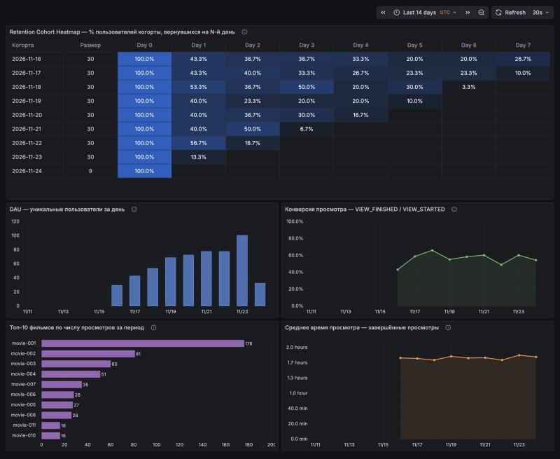

# ДЗ №5 — Online Cinema: Event Streaming + Analytics Pipeline

Pipeline обработки событий онлайн-кинотеатра. Python 3.12, FastAPI, confluent-kafka (Avro + Schema Registry),
Kafka 4.1 (3 брокера, KRaft), ClickHouse 25.8, PostgreSQL 16 + Flyway, Grafana 12.3, MinIO (S3).



- **Movie Service (producer)** — принимает события по HTTP и сам генерирует синтетические сессии просмотра;
  публикует их в topic `movie-events` в формате Avro.
- **Kafka + Schema Registry** — 3 брокера с репликацией, схема события версионируется в Schema Registry.
- **ClickHouse** — читает топик таблицей Kafka Engine, хранит raw-события в MergeTree и агрегаты в `agg_*`.
- **Aggregation Service** — по расписанию и по HTTP-запросу считает метрики из raw-событий, сохраняет их в ClickHouse
  и PostgreSQL, раз в день выгружает метрики из PostgreSQL в S3.
- **Grafana** — дашборд по агрегатам ClickHouse, включая Retention Cohort Heatmap.

## Запуск

```bash
docker compose up --build
```

Ручных шагов нет. Порядок старта задан через `depends_on` с healthcheck:
`kafka-1..3` → `kafka-init` (создаёт топик и завершается) и `schema-registry` → `clickhouse` → `clickhouse-migrations`
(завершается); `postgres` → `postgres-migrations` (Flyway, завершается); `minio`; затем `producer`,
`aggregation-service`, `grafana`.

Старт занимает около 35 секунд. Затем генератор до минуты публикует историю за 8 прошлых дней (в логе —
`backfill finished`) и дальше шлёт события за сегодня. Агрегаты пересчитываются каждые 30 секунд, поэтому дашборд
заполняется через 1–2 минуты после старта.

| Что | Где |
|---|---|
| Grafana, дашборд «Online Cinema — аналитика» (открывается без логина; редактирование — `admin` / `admin`) | http://localhost:3000 |
| Movie Service: `POST /events` (Swagger UI — `/docs`) | http://localhost:8000 |
| Aggregation Service: `POST /aggregate`, `POST /export`, `GET /metrics` (Swagger UI — `/docs`) | http://localhost:8001 |
| Schema Registry | http://localhost:8081 |
| ClickHouse HTTP (`cinema` / `cinema`, БД `cinema`) | http://localhost:8123 |
| PostgreSQL (`analytics` / `analytics`, БД `analytics`) | `localhost:15440` |
| MinIO: S3 API и консоль (`minioadmin` / `minioadmin`) | http://localhost:9000, http://localhost:9001 |

Тесты (п.4) — одной командой; образ тестов собирается при первом запуске, нужные сервисы поднимаются сами:

```bash
docker compose run --rm tests
```

Остановить и удалить данные:

```bash
docker compose down -v
```

## Структура

```
schemas/movie_event.avsc              Avro-схема события (единственный источник: её регистрирует и по ней валидирует producer)
docker-compose.yml                    вся система
producer/                             Movie Service
  app/main.py                         FastAPI: POST /events, GET /health
  app/schemas.py                      модель входящего события (pydantic)
  app/publisher.py                    регистрация схемы, Avro, Kafka-продюсер: acks, ключ, retry, лог публикации
  app/generator.py                    генератор сессий: история за прошлые дни + поток за сегодня
clickhouse/
  migrations/V1__raw_events.sql       Kafka Engine → Materialized View → MergeTree
  migrations/V2__aggregates.sql       таблицы агрегатов agg_* (ReplacingMergeTree)
  Dockerfile, migrate.sh              контейнер, применяющий миграции при старте
aggregation-service/
  db/migration/V1__init.sql           PostgreSQL: таблица daily_metrics (Flyway)
  app/main.py                         FastAPI + планировщик (APScheduler): расписание, ручной запуск
  app/queries.py                      SQL метрик для ClickHouse
  app/aggregation.py                  цикл: raw → агрегаты ClickHouse → PostgreSQL, лог цикла
  app/storage.py                      UPSERT в PostgreSQL с retry
  app/export.py                       выгрузка метрик за день в S3 (CSV)
grafana/
  provisioning/                       datasource ClickHouse и провайдер дашбордов
  dashboards/movie-analytics.json     дашборд
tests/                                интеграционные тесты (pytest в контейнере)
docs/architecture.puml (+ .svg)       диаграмма контейнеров
docs/dashboard.jpg                    скриншот дашборда
```

## Соответствие пунктам

| # | Пункт | Реализация |
|---|---|---|
| 1 | Topic и схема события | [`schemas/movie_event.avsc`](schemas/movie_event.avsc) — Avro. Producer при старте регистрирует её в Schema Registry (subject `movie-events-value`) и пишет в лог id и версию. Topic `movie-events` создаёт `kafka-init`: 3 партиции. Ключ — `user_id` (обоснование ниже) |
| 2 | Продюсер | [`producer/`](producer): `POST /events` (pydantic → 422 при ошибке, 201 + `event_id` при успехе) и генератор сессий. Перед отправкой — валидация по Avro-схеме, ключ `user_id`, `acks=all`, retry с экспоненциальной паузой 200 → 400 мс, лог `published event_id=… event_type=… timestamp=…` |
| 3 | ClickHouse | [`V1__raw_events.sql`](clickhouse/migrations/V1__raw_events.sql): `movie_events_queue` (Kafka Engine, `AvroConfluent`) → `movie_events_mv` (Materialized View) → `movie_events` (MergeTree, `PARTITION BY toYYYYMM(event_date)`, `ORDER BY (event_date, event_type, user_id)`). Типы колонок повторяют Avro-схему |
| 4 | Интеграционный тест | [`tests/test_pipeline.py`](tests/test_pipeline.py): публикует событие через HTTP API продюсера, ждёт его в ClickHouse, сверяет все поля. Тестовые события датированы январём 2001 года и удаляются до и после каждого теста |
| 5 | Сервис агрегации | [`aggregation-service/`](aggregation-service): отдельный контейнер, читает только ClickHouse. Расписание — `AGGREGATION_INTERVAL_SECONDS`, ручной запуск — `POST /aggregate?date=`. Метрики: DAU, среднее время просмотра, рейтинг фильмов, конверсия, retention D1/D7 ([`queries.py`](aggregation-service/app/queries.py)). Результаты — в таблицах `agg_*` ClickHouse и в `daily_metrics` PostgreSQL (UPSERT, retry) |
| 6 | Grafana | [`grafana/`](grafana): datasource ClickHouse и дашборд подключаются при старте. Панели читают только `agg_*`: Retention Cohort Heatmap, DAU, конверсия, топ фильмов, среднее время просмотра |
| 7 | Экспорт в S3 | [`export.py`](aggregation-service/app/export.py): метрики за день из PostgreSQL → `s3://movie-analytics/daily/YYYY-MM-DD/aggregates.csv`. По cron (`EXPORT_CRON`, по умолчанию 00:05 UTC за вчера) и вручную — `POST /export?date=`. Повторный экспорт перезаписывает файл |
| 8 | Отказоустойчивая Kafka | 3 брокера (KRaft), topic с `replication.factor=3`, `min.insync.replicas=2`, Schema Registry, healthcheck у всех долгоживущих контейнеров |

## п.1. Схема события и ключ партиционирования

| Поле | Avro | ClickHouse |
|---|---|---|
| `event_id` | `string`, logicalType `uuid` | `UUID` |
| `user_id`, `movie_id`, `session_id` | `string` | `String` |
| `event_type` | `enum EventType` | `Enum8` с теми же значениями |
| `timestamp` | `long`, logicalType `timestamp-millis` | `DateTime64(3, 'UTC')` |
| `device_type` | `enum DeviceType` | `Enum8` |
| `progress_seconds` | `["null", "int"]`, по умолчанию `null` | `Nullable(Int32)` |

`progress_seconds` заполняется только у событий просмотра (`VIEW_*`), у `LIKED` и `SEARCHED` он `null`.

Версия схемы:

```bash
curl -s http://localhost:8081/subjects/movie-events-value/versions          # [1]
curl -s http://localhost:8081/subjects/movie-events-value/versions/latest   # subject, version, id, schema
```

Сообщение в Kafka — формат Confluent: байт `0`, 4 байта id схемы, затем Avro. По этому id ClickHouse сам берёт схему
в Schema Registry. Изменённая схема регистрируется как версия 2; Schema Registry примет её, только если она
обратно совместима (режим `BACKWARD` по умолчанию) — например, новое поле со значением по умолчанию.

**Ключ партиционирования — `user_id`.**

- Kafka гарантирует порядок только внутри партиции. Сообщения с одним ключом попадают в одну партицию, значит,
  события одного пользователя читаются в том порядке, в котором были отправлены: `VIEW_STARTED` раньше
  `VIEW_FINISHED`, прогресс растёт. Аналитика (сессии, конверсия, retention) строится вокруг пользователя.
- Пользователей много, и активность каждого мала по сравнению с общим потоком — партиции загружены равномерно.
- С ключом `movie_id` популярный фильм (премьера) давал бы «горячую» партицию, а события одного пользователя
  о разных фильмах расходились бы по разным партициям и теряли взаимный порядок.

## п.2. Movie Service

`POST /events` — тело:

```json
{
  "user_id": "user-1",
  "movie_id": "movie-001",
  "event_type": "VIEW_STARTED",
  "device_type": "TV",
  "session_id": "session-1",
  "progress_seconds": 0
}
```

`event_id` (UUID) и `timestamp` (ISO 8601) можно не передавать — сервис подставит новый UUID и текущее время UTC.

| Ответ | Когда |
|---|---|
| `201 {"event_id": "…"}` | брокеры подтвердили запись |
| `422` | событие не прошло проверку: неизвестное значение enum, нет `progress_seconds` у `VIEW_*`, отрицательный прогресс, лишнее поле и т.п. |
| `503` | Kafka не подтвердила запись после всех попыток |

Настройки продюсера ([`publisher.py`](producer/app/publisher.py)):

- **Валидация по схеме** — `fastavro.validate` по той же `.avsc`, что зарегистрирована в Schema Registry. Через неё
  проходят и события из HTTP, и события генератора.
- **`acks=all`** — запись подтверждена, когда её получили все in-sync реплики; вместе с `min.insync.replicas=2`
  подтверждённое событие лежит минимум на двух брокерах. `enable.idempotence=true` — внутренние повторы клиента
  не создают дублей и не меняют порядок.
- **Retry** — попытка ждёт подтверждения до 5 с (`message.timeout.ms`); при ошибке повтор через 200 мс, затем 400 мс
  (`PUBLISH_MAX_ATTEMPTS=3`, `PUBLISH_RETRY_BASE_DELAY_MS=200`), после этого — `503`.
- **Лог** — `published event_id=… event_type=… timestamp=… partition=… offset=…`.

**Генератор** ([`generator.py`](producer/app/generator.py)) строит сессии просмотра одного фильма:

```
[SEARCHED] → VIEW_STARTED → (VIEW_PAUSED → VIEW_RESUMED)* → [VIEW_FINISHED → [LIKED]]
```

Время событий внутри сессии только растёт, `progress_seconds` не убывает, `VIEW_FINISHED` есть только после
`VIEW_STARTED` той же сессии. 60% сессий досматриваются до конца, первые фильмы каталога популярнее остальных.
При старте создаётся история за `GENERATOR_BACKFILL_DAYS=8` дней: каждый день приходят новые пользователи,
а прежние возвращаются с вероятностью 45% на первый день и дальше по убывающей — поэтому retention похож на настоящий.
История пишется только в пустой топик: перезапуск сервиса не создаёт её второй раз.
Потом генератор шлёт `GENERATOR_SESSIONS_PER_MINUTE=20` сессий в минуту за сегодня. `GENERATOR_ENABLED=false` выключает его.

## п.3. ClickHouse

```
movie_events_queue (Kafka Engine, AvroConfluent)  ──movie_events_mv──▶  movie_events (MergeTree)
```

- `movie_events_queue` — потребитель топика (consumer group `clickhouse-movie-events`), данных не хранит.
- `movie_events_mv` — Materialized View: каждый прочитанный из Kafka блок вставляет в `movie_events`.
- `movie_events` — постоянное хранение. `PARTITION BY toYYYYMM(event_date)`: партиций немного, старый месяц удаляется
  целиком. `ORDER BY (event_date, event_type, user_id)`: все метрики считаются за день, почти все фильтруют по типу
  события, DAU и retention считают уникальных пользователей. `event_date` — вычисляемая колонка `toDate(timestamp)`.

## п.5. Метрики

Один цикл ([`aggregation.py`](aggregation-service/app/aggregation.py)): `INSERT … SELECT` из `movie_events` в таблицы
`agg_*` → чтение готовых агрегатов → UPSERT в PostgreSQL. В логе — начало и конец цикла:

```
aggregation cycle started (schedule): 2026-11-16 .. 2026-11-24
aggregation cycle finished (schedule): 2026-11-16 .. 2026-11-24, processed 2852 events, wrote 283 metrics in 0.12 s
```

Плановый цикл пересчитывает сегодня и `AGGREGATION_LOOKBACK_DAYS=8` предыдущих дней: туда попадают опоздавшие события,
а запись идемпотентна. Ручной запуск считает ровно одну дату:

```bash
curl -s -X POST 'http://localhost:8001/aggregate?date=2026-11-24'
curl -s 'http://localhost:8001/metrics?date=2026-11-24'
```

| Метрика (`metric_name`) | Как считается | Таблица ClickHouse |
|---|---|---|
| `dau` | `uniqExact(user_id)` за день | `agg_daily_metrics` |
| `avg_watch_seconds` | `avgIf(progress_seconds, event_type = 'VIEW_FINISHED')` | `agg_daily_metrics` |
| `views_started`, `views_finished`, `view_conversion_pct` | `uniqExactIf(event_id, …)`; конверсия = finished / started × 100 | `agg_daily_metrics` |
| `movie_views` (разрез — `movie_id`) | просмотры (`VIEW_STARTED`) по фильмам; место в рейтинге — `row_number() OVER (PARTITION BY event_date ORDER BY views DESC)` | `agg_top_movies` |
| `retention_d1_pct`, `retention_d7_pct` | доля когорты, вернувшаяся на 1-й и 7-й день | `agg_retention_cohorts` |

**Retention.** Когорта пользователя — дата его первого просмотра (`VIEW_STARTED`). «Вернулся на N-й день» — у пользователя
есть любое событие в день «дата когорты + N». В `agg_retention_cohorts` лежит клетка на каждую пару (когорта, день 0..7).
Метрика дня в PostgreSQL: `retention_d1_pct` за дату X — доля когорты X−1, вернувшаяся в день X; `retention_d7_pct` —
доля когорты X−7. Так все метрики за день зависят только от событий до конца этого дня и не меняются задним числом.

Количество считается как `uniqExact(event_id)`, а не `count()`: доставка из Kafka — at-least-once, и повторно
доставленное событие не должно попасть в метрику дважды.

**ClickHouse.** Таблицы `agg_*` — `ReplacingMergeTree(computed_at)`: UPSERT в ClickHouse нет, поэтому пересчёт вставляет
строку с тем же ключом и новым `computed_at`, а читатели (`FINAL`) видят самую свежую.

**PostgreSQL.** Одна таблица, одна строка — одно значение метрики за день:

```sql
daily_metrics (metric_date, metric_name, dimension, value, computed_at,
               PRIMARY KEY (metric_date, metric_name, dimension))
```

Запись — `INSERT … ON CONFLICT (metric_date, metric_name, dimension) DO UPDATE`: пересчёт за ту же дату обновляет
значение и `computed_at`, строки не дублируются. Все метрики цикла пишутся одной транзакцией. Если PostgreSQL
недоступен — до 3 попыток с паузами 500 мс и 1 с, затем ошибка в лог; следующий плановый цикл посчитает заново.

## п.6. Grafana

http://localhost:3000 — дашборд открывается как домашняя страница. Datasource (плагин `grafana-clickhouse-datasource`)
и дашборд лежат в образе и подключаются через provisioning.



| Панель | Источник |
|---|---|
| **Retention Cohort Heatmap** — строки: когорты по дате первого просмотра, столбцы: Day 0 … Day 7, в клетке % вернувшихся; цвет — по значению | `agg_retention_cohorts` |
| DAU | `agg_daily_metrics` |
| Конверсия просмотра | `agg_daily_metrics` |
| Топ-10 фильмов за период | `agg_top_movies` |
| Среднее время просмотра | `agg_daily_metrics` |

Нетривиальный запрос когортного анализа — [`INSERT_RETENTION_COHORTS`](aggregation-service/app/queries.py): дата первого
просмотра каждого пользователя → размер когорт → число активных пользователей когорты по дням. Панель только разворачивает
готовые клетки в столбцы (`maxOrNullIf(retention_pct, day_number = N)`); день, который ещё не наступил, остаётся пустым.
Последняя заполненная клетка каждой строки — сегодняшний день, он ещё идёт, поэтому значение в ней растёт.

## п.7. Экспорт в S3

```bash
curl -s -X POST 'http://localhost:8001/export?date=2026-11-23'
# {"date":"2026-11-23","path":"s3://movie-analytics/daily/2026-11-23/aggregates.csv","rows":42}
```

Файл — CSV со всеми метриками за день (здесь — часть строк):

```
metric_date,metric_name,dimension,value,computed_at
2026-11-23,avg_watch_seconds,,6613.90,2026-11-24T15:41:38+00:00
2026-11-23,dau,,101.00,2026-11-24T15:41:38+00:00
2026-11-23,movie_views,movie-001,35.00,2026-11-24T15:41:38+00:00
2026-11-23,retention_d1_pct,,56.67,2026-11-24T15:41:38+00:00
2026-11-23,retention_d7_pct,,26.67,2026-11-24T15:41:38+00:00
2026-11-23,view_conversion_pct,,60.29,2026-11-24T15:41:38+00:00
```

- Ключ объекта зависит только от даты, поэтому повторный экспорт перезаписывает файл.
- По расписанию (`EXPORT_CRON`, cron в UTC, по умолчанию `5 0 * * *`) выгружается вчерашний день.
- PostgreSQL или S3 недоступен → ошибка в лог, дата остаётся в списке невыгруженных и повторяется при следующем запуске
  по расписанию вместе с новой. Список хранится в памяти сервиса: после его перезапуска такую дату выгружают вручную.
- Запуск, пропущенный по времени (машина спала, контейнер стоял на паузе), не теряется: планировщик выполняет его
  сразу после пробуждения (`misfire_grace_time=None`).
- Бакет `movie-analytics` сервис создаёт сам при первом экспорте. Файлы видны в консоли MinIO: http://localhost:9001.

## п.8. Отказоустойчивость Kafka

Три узла в режиме KRaft, каждый — и брокер, и контроллер. Узлов три, а не два: кворуму контроллеров нужно большинство,
и из двух узлов нельзя потерять ни одного. `replication.factor=3`, `min.insync.replicas=2`, продюсер пишет с `acks=all`:
при потере одного брокера запись и чтение продолжаются, подтверждённые события не теряются.

```bash
make topic                         # Replicas: 1,2,3   Isr: 1,2,3
docker compose stop kafka-2
make topic                         # через ~10 с: лидеры переизбраны, Isr без брокера 2
curl -s -X POST http://localhost:8000/events -H 'Content-Type: application/json' \
  -d '{"user_id":"u1","movie_id":"movie-001","event_type":"LIKED","device_type":"TV","session_id":"s1"}'   # 201
docker compose start kafka-2       # брокер догоняет реплики и возвращается в Isr
```

Если остановить два брокера из трёх, запись не подтверждается: продюсер делает три попытки с паузами 200 и 400 мс
и отвечает `503`.

Healthcheck: `kafka-1..3` (`kafka-broker-api-versions.sh`), `schema-registry` (`/subjects`), `clickhouse` (`/ping`),
`postgres` (`pg_isready`), `minio` (`/minio/health/live`), `grafana` (`/api/health`), `producer` и
`aggregation-service` (`/health`). Контейнеры `kafka-init`, `clickhouse-migrations`, `postgres-migrations` разовые:
от них зависят через `service_completed_successfully`.

## Принятые решения

- **Одна Avro-схема на всё.** Файл `.avsc` — источник и для регистрации в Schema Registry, и для валидации в продюсере;
  ClickHouse получает ту же схему из Registry. Колонки ClickHouse описаны вручную и повторяют её.
- **Миграции.** PostgreSQL — Flyway, как в прошлых ДЗ. ClickHouse — отдельный контейнер, который при каждом старте
  выполняет `clickhouse/migrations/*.sql` по порядку; все запросы `CREATE … IF NOT EXISTS`, повторный запуск безопасен.
- **Доставка at-least-once.** Продюсер повторяет отправку, Kafka Engine при сбое может прочитать блок повторно. Потери
  исключены, дубль возможен — поэтому у события есть `event_id`, а метрики считают уникальные `event_id`.
- **Экспорт живёт в Aggregation Service** отдельной задачей планировщика: читает только PostgreSQL, от цикла агрегации
  не зависит.
- **Без томов.** Данные живут в контейнерах: `docker compose stop/start` их сохраняет, `docker compose down -v` —
  чистый старт всей системы сразу.
- **Образ MinIO — `alpine/minio`**: официальные образы `minio/minio` удалены с Docker Hub, это сборка того же MinIO.
